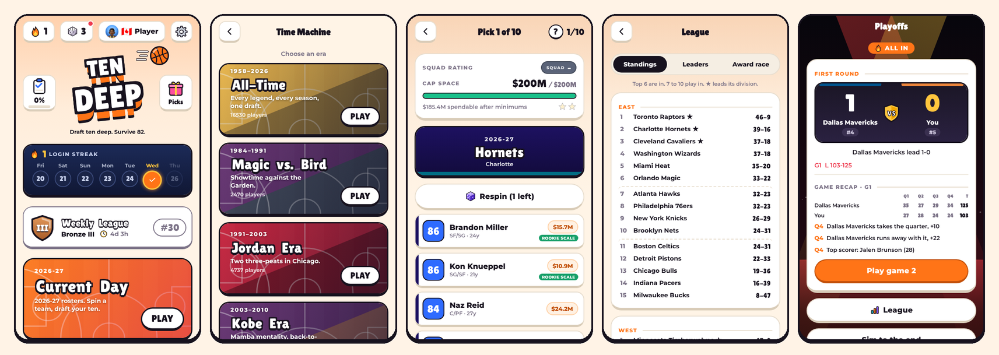

# Ten Deep

**Play it: [ten-deep.vercel.app](https://ten-deep.vercel.app)** (I'm currently building this; it's playable now and changing often.)

**Draft ten deep. Survive 82.** An NBA draft-and-simulate game: spin a team or era, draft a 10-man rotation under a salary cap, then watch your season, the trade deadline and the playoffs play out.



## What's in the game

- **Draft:** spin a team-season and pick one player from it, ten times, for a 10-man rotation (PG, SG, SF, PF, C and five bench) under a $200M cap. Every player costs his **real contract for that season** (salary ÷ that season's cap × $171M, so a 35% supermax is $60M), labeled rookie scale, max, supermax, two-way or minimum. At most two players rated 95+. One respin per draft, at the top of the board. The cap reserve knows the player pool, so a draft can never dead-end.
- **Squad Rating:** your starting five count 15% each, the bench 9/6/5/3/2%. That one number drives the season: about 74–76 wins at 91, and an 82-0 season is possible with a 93 (see `src/engine/calibration.test.ts`).
- **Season:** pick your conference and division, then play 82 games at your chosen sim speed (with skip buttons). Injuries cost exactly the games they say, and you get one swap at the game-50 trade deadline. Every other team plays with its **real roster** for that season.
- **Playoffs:** a play-in (7 v 8, 9 v 10, last chance), then East and West brackets of best-of-7 series, played game by game in a bracket colored by team. The Finals go to the better record for home court.
- **"Why 47 wins?":** the result screen explains your record: Squad Rating against the league, point differential and the wins it usually means, close games, injuries, form and your longest streak.
- **Modes:**
  - **Current Day** (2026-27 rosters)
  - **Time Machine:** All-Time, Magic vs. Bird (1984–1991), Jordan (1991–2003), Kobe (2003–2010), LeBron (2010–2016), Steph (2016–2020) and Modern (2020–2026). Every team and every player of every season from 1984 to 2026 is in, with real contracts.
  - **All-Time Franchises:** all 30 franchises
  - **Management Crisis:** the board sets a goal, and a crisis card lands every two months
  - **Career:** one franchise across seasons, with aging, contracts, a draft lottery, free agency, offseason trades, morale, franchise records and a Hall of Fame, until the board fires you
- **Daily and weekly:** Daily Draft (the same spins for everyone), Trivia, Player Rank, Team Rank, 1v1 Derby and Team Duel, one shot each per day. The **Weekly Challenge** is one shared draft a week with a leaderboard and end-of-week prizes.
- **Friends:** pass-and-play duels, friend codes, challenge links, and live Party rooms.
- **Player Picks (packs):** earned by drafting well, not by grinding, and at most two per run. The season pays one pick: a Run Pick, a Good Pick at 60+ wins, or a Legendary Pick for 82-0. The playoffs can add one more, bigger the deeper you go: Conference Finals, Finals, a title, a 4-0 Finals sweep, and an Ultimate Pick (98+ cards only) for 82-0 and 16-0. Odds are published. One power-up a day, and never more than one on the same pack. Duplicates level a card up (+1 rating, max +3).
- **Card lineups and the Gauntlet:** field your cards as a 10-man lineup with chemistry bonuses, then beat 10 historic teams from good to all-time great.
- **Missions and achievements:** 3 daily and 3 weekly missions, and bronze, silver and gold achievements.
- **Stats and story:** league leaders, live MVP, DPOY, ROY and Sixth Man races, a season news feed, box scores, playoff game recaps and season awards.
- **Profile and cloud save:** drafts played, titles, best record, original illustrated portraits (no real likenesses), and a recovery code (or Apple/Google sign-in) to move your progress to a new device.
- **Feel:** synthesized sound effects with a volume control, no music, haptics on phones, team-color washes, confetti.
- **Notifications** (phones): daily challenge ready at 9:00, and a streak reminder at 19:00 if you haven't drafted.
- **11 languages:** English, French, Spanish, Portuguese, Turkish, Italian, Dutch, German, Japanese, Korean and Arabic (right-to-left), with each language's own plural forms.
- **Settings and legal:** sound volume, haptics, notifications, sim speed, nationality, language, Privacy Policy, Terms, Contact, and Delete account (wipes all data, including server copies).

## Run it on any laptop

Requires Node.js 22+.

```bash
git clone https://github.com/RyanRaiSaini/Ten-Deep.git
cd Ten-Deep
npm install
npm run web        # opens the game in your browser
```

Phone: install **Expo Go**, run `npm start`, and scan the QR code. Notifications, haptics and native right-to-left need a development build (`npx eas-cli@latest build --profile development`).

| Command | What it does |
|---|---|
| `npm test` | About 500 tests: engine, calibration, draft and duel fuzzing, rosters and contracts, i18n, stores, API |
| `npm run smoke` | Builds the web app and plays the whole game in a headless browser |
| `npm run typecheck` | TypeScript check |
| `npm run review` | Regenerates the ratings review sheets in `docs/ratings-review/` |
| `npm run calibrate` | Difficulty report (e.g. `npm run calibrate -- 40 k=0.014`) |
| `npm run build:web` | Static web build into `dist/` (deployable as-is; `vercel.json` included) |

## Project map

```
src/app/          screens (Expo Router)
src/engine/       pure, seeded game engine: cap, draft, duel, AI league, game sim, season, playoffs, daily challenges,
                  crisis cards, career, collectibles, missions/achievements, stats and story
src/data/         2026 pool, every team-season 1984-2026 (history/full), mode definitions
src/store/        persisted state (run, profile, settings, daily, duel, career, collection, progress)
src/ui/           design system, portraits, logo, cards, effects, spinner, roster board
src/audio/        synthesized sound effects (rendered to files for iOS/Android)
src/notifications/ local reminder rules + scheduling
src/i18n/         11 locales
src/outreach/     private creator-outreach workspace logic (admin at /admin; see docs/outreach/README.md)
api/              Vercel functions: cloud save, sign-in, Party rooms, Weekly Challenge, PINs
scripts/          smoke tests, calibration, roster and contract builders
docs/             design specs, plans, ratings review sheets, store listing draft
```

The private creator-outreach admin (`/admin`, behind `ADMIN_KEY`) is documented in [docs/outreach/README.md](docs/outreach/README.md).

## Not built yet

- **Ads** (e.g. ad-unlocked trade-deadline swaps).
- **App-store release:** `eas.json` is ready, and `docs/store/listing.md` has the listing text, screenshot plan and submit commands. It needs Apple and Google developer accounts, and a decision on player-name licensing (see the top of that file).
